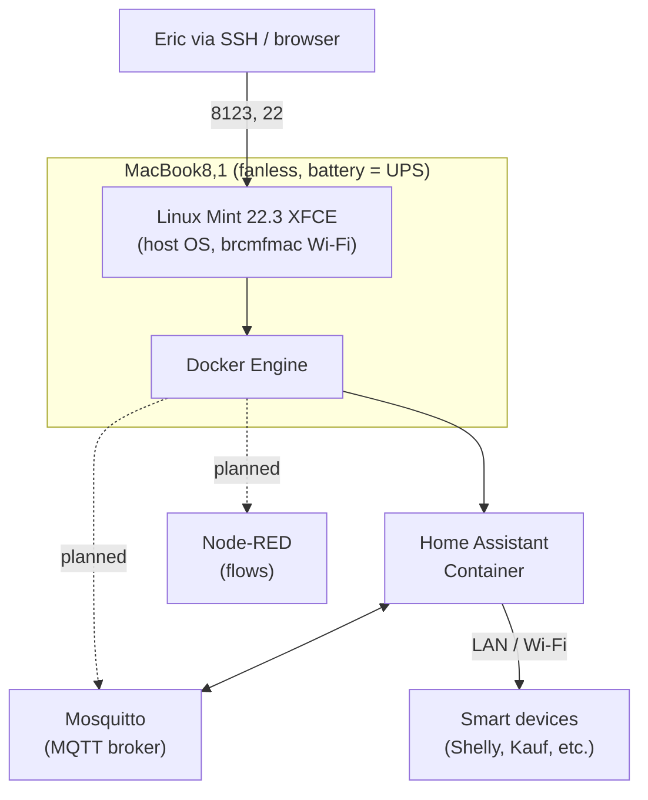

# macbook-home-hub

<!-- CONSTITUTION_START -->
[](https://github.com/esanacore/engineering-constitution)
<!-- CONSTITUTION_END -->

Turning a 2015 12-inch Retina MacBook (`MacBook8,1`, fanless Core M Broadwell,
8 GB soldered RAM, single USB-C) into a silent, always-on Linux tinkering box
that doubles as a home-automation hub running Home Assistant in Docker.

The machine's quirk is its strength here: the built-in battery acts as a free
UPS, so the hub rides through power blips that would hard-cut a Pi or NUC.

Status: running. As of 2026-10-12 the MacBook (`peppermint-patty`) runs
Linux Mint 22.3 XFCE, is provisioned, serves Home Assistant 2026.8.0 on
`:8123`, and comes back on its own after a reboot. The lid-closed test,
onboarding, and a backup job are still ahead. The specific devices and
companion services are still open.

## Current Capabilities

Honest snapshot of what this repo covers today. This list grows as the project does.

- Documents the target hardware and its Linux-specific gotchas (Broadcom
  BCM4350 Wi-Fi, lid-switch suspend, battery longevity).
- Records the platform decision: lightweight Linux base + Home Assistant
  Container (Docker), not Home Assistant OS.
- Holds the operational runbook for running a laptop as an always-on hub.
- Defines 12 requirements with acceptance criteria (`docs/PRODUCT_REQUIREMENTS.md`)
  and tracks each to its verifying check (`docs/REQUIREMENTS_TRACEABILITY.md`).
- Declares the stack in `compose/docker-compose.yml`: Home Assistant Container
  pinned to a dated tag, host networking, config bind-mounted from `config/`.
- Provisions the host with one reviewable root-level command
  (`sudo bash scripts/provision_host.sh`): logind lid-switch drop-in, sleep
  targets masked, SSH and Docker installed and enabled, idempotent, refuses to
  run on the wrong hardware.
- Verifies the host without root (`bash scripts/check_host_config.sh`) by
  reading the live logind, systemd, Docker and XFCE power-manager state, with
  its own fixture-driven unit tests.
- Runs a real check suite with `bash scripts/run_tests.sh`: governance and
  secret sweeps anywhere; host-config and compose validation on the hub; a
  smoke check (`scripts/smoke_check.sh`) against a running hub.

Not yet: the 30-minute lid-closed test, onboarding, a backup job, or any
device integrations. Six of twelve requirements have a passing check that ran
on the hub; the rest wait on physical tests or adoption decisions — see the
gap log in `docs/TEST_PLAN.md` and `TODO.md`.

## Running the Checks

```bash
git submodule update --init --recursive   # constitution/ is a submodule
bash scripts/run_tests.sh                 # full suite; host checks SKIP off-hub
HUB_HOST=<hub-ip> bash scripts/run_tests.sh   # includes the hub smoke check
```

## Getting Started

Provisioning steps live in `docs/SETUP.md`. High level:

1. Flash a Linux Mint XFCE live USB and **verify it** against the ISO's manifest.
2. Install to the internal SSD. Wi-Fi works out of the box (`brcmfmac`); no
   dongle and no `broadcom-sta-dkms`.
3. Repository tooling: submodule, `pre-commit`, gstack (Part 1).
4. `sudo bash scripts/provision_host.sh`, reboot, `bash scripts/check_host_config.sh`.
5. `docker compose -f compose/docker-compose.yml up -d` and onboard Home Assistant.

## Project Structure

```text
macbook-home-hub/
├── compose/         ← docker-compose stack (Home Assistant; companions deferred)
├── config/          ← Home Assistant configuration bind mount (created on first start; runtime state gitignored)
├── scripts/         ← run_tests.sh, smoke_check.sh, provision_host.sh, check_host_config.sh (+ tests)
├── docs/            ← architecture, operations, requirements, ADRs, setup
└── constitution/    ← Eric's Engineering Constitution (git submodule)
```

## System Overview



## Documentation

- Roadmap: `TODO.md`
- Changelog: `CHANGELOG.md`
- Architecture decisions: `docs/adr/`
- Architecture overview and layers: `docs/ARCHITECTURE.md`
- Operations runbook: `docs/OPERATIONS.md`
- Off-the-shelf software inventory: `docs/OTS_SOFTWARE.md`
- Setup: `docs/SETUP.md`

## Contributing

Before completing work:

- Update tests.
- Update documentation.
- Update TODO.md.
- Update CHANGELOG.md for user-facing changes.
- Review security impact.
